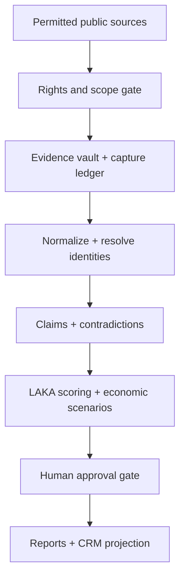

# Solution Architecture

## 1. Architectural rule

The system is not `crawler → vector database → report → CRM`. It has six planes with different truth and control boundaries:

| Plane | Authoritative records | Primary rule |
| --- | --- | --- |
| Evidence | sources, captures, passages, extraction runs | Preserve what was actually observed |
| Claims | propositions, versions, contradictions, review decisions | Interpretations are versioned, not overwritten |
| Identity | entities, identifiers, relationships, merge/split decisions | Probabilistic resolution remains reversible |
| Economics | models, inputs, scenarios, estimate runs | Assumptions never become facts |
| Activation | approved insights, reports, outreach, CRM projections | Release only reviewed, purpose-fit data |
| Privacy | purpose, consent/basis, suppression, retention, deletion ledger | Privacy constraints govern every other plane |

PostgreSQL is the canonical system of record. Search indexes, embeddings, graphs, warehouses, dashboards, reports, and CRM rows are rebuildable projections.

## 2. Reference topology



Cross-cutting services are policy enforcement, secrets, tenant isolation, provenance, observability, suppression, retention, and deletion.

## 3. Minimal production stack

- PostgreSQL for canonical OLTP, bitemporal claims, range constraints, row-level security, full-text search, `pgvector`, privacy state, and transactional outbox.
- Encrypted S3-compatible storage for exact source captures and generated artifacts.
- FastAPI or an equivalent typed service boundary for policy-enforced access.
- Prefect for an initial analytical pipeline; Temporal when long-running approvals, compensation, and deletion workflows require stronger durability.
- DuckDB plus Parquet for local analytical projections.
- OIDC identity, least-privilege service accounts, and a secrets/KMS service such as OpenBao or the deployment platform’s managed KMS.
- OpenTelemetry, Prometheus, Grafana, and centralized structured logs.
- Direct CRM connector or sanitized CSV export with idempotent receipts.

Add Debezium/Kafka, OpenSearch, a warehouse, a graph database, or a dedicated vector service only after a measured bottleneck justifies its extra synchronization and erasure cost.

## 4. Canonical data model

### 4.1 Evidence plane

| Table | Required fields |
| --- | --- |
| `source` | publisher, source type, authority, jurisdiction, access method, rights/terms class |
| `artifact` | source, original/canonical URL, published/observed/retrieved times, SHA-256, MIME, optional storage URI, PII class, retention rule |
| `passage` | artifact, page/DOM/media/byte locator, excerpt hash, short extract |
| `extraction_run` | tool/model/version, parameters, prompt-template hash, input/output hashes, reviewer |
| `provenance_event` | activity, agent, inputs, outputs, software/policy version |

Map portable lineage to [W3C PROV-O](https://www.w3.org/TR/prov-o/) and job/run lineage to the [OpenLineage object model](https://openlineage.io/docs/spec/object-model/).

An artifact hash proves post-capture integrity, not source truth, authenticity, or capture time. Store exact bytes only when source rights and necessity authorize retention; otherwise retain the minimum authorized extract, locator, metadata, and digest. Keep any retained source artifact separate from cleaned text, OCR, screenshots, chunks, translations, and embeddings.

### 4.2 Claim plane

| Table | Required fields |
| --- | --- |
| `claim` | stable subject–predicate–object semantic slot plus geography, product, population, and unit scope |
| `claim_version` | value, modality, polarity, state, lifecycle, valid range, system range |
| `evidence_link` | claim version, passage, supports/refutes/contextualizes, directness, independence group |
| `claim_relation` | contradicts/revises/supersedes/duplicates/refines/depends_on plus rationale |
| `review_decision` | decision, reviewer, reason, time, superseding version |

Use independent times:

- `valid_from` / `valid_to`: when the assertion applied in the world.
- `system_from` / `system_to`: when the system knew or accepted it.
- `published_at`, `observed_at`, and `retrieved_at`: separate source events.

Use half-open ranges `[from, to)` and non-overlap constraints for accepted versions. PostgreSQL documents the relevant [range types and constraints](https://www.postgresql.org/docs/current/rangetypes.html). Expose `current_best`, `valid_at(t)`, and `as_known(valid_t, system_t)` query contracts.

### 4.3 Identity plane

Minimum records:

```text
entity
identifier
source_identity
identity_assertion
cannot_link
resolution_decision
entity_cluster_membership
entity_relationship
contact_point
contact_verification
```

Preserve source identities after a merge. Every resolution decision stores candidate entities, match features, rules/model version, calibrated probability, supporting and conflicting evidence, decision type, reviewer, reason, and effective/system times. Support `merge`, `split`, `same_as`, `possible_same`, and `not_same`.

Distinct concepts must remain distinct:

- person versus job title;
- employer versus time-bounded employment;
- domain versus legal entity;
- email pattern versus actual address;
- discovered address versus verified address;
- verified address versus lawful outreach authorization.

### 4.4 Economics plane

Every dollar output is an immutable `estimate_run`:

```text
estimate_model(formula, code_hash, version, output_unit)
estimate_input(value_or_distribution, unit, currency, evidence_claim_or_assumption)
estimate_run(frozen_inputs, scenario, horizon, price_year, fx_date, random_seed)
estimate_output(p10, p50, p90, sensitivity, confidence_class)
impact_dependency(overlap, causal_dependency, mutual_exclusion_group)
```

Use numeric result classes `REPORTED_OR_MEASURED`, `DETERMINISTIC_CALCULATION`, `ESTIMATE`, and `SCENARIO`. They are orthogonal to the canonical claim states O/C/I/H/U/X. “Exact” is allowed only for deterministic arithmetic over reconciled historical inputs; forecasts, causal effects, adoption, and future ROI remain estimates or scenarios even when inputs are company-confirmed. Retractions and revisions mark dependent outputs `needs_recompute`.

### 4.5 Activation plane

CRM is a sink, not an evidence, claim, or identity master. Every outbound candidate requires:

```yaml
candidate_id: ""
entity_id: ""
approved_claim_version_ids: []
safe_pitch_angle: ""
jurisdiction: ""
purpose: ""
lawful_basis_or_consent_basis: ""
suppression_checked_at: ""
freshness_expires_at: ""
approved_by: ""
approved_at: ""
```

Only an `activation_safe_claim` view is visible to outreach generation. It excludes credential or breach contents, exploit details, protected-attribute or sensitive inferences, private-person information unrelated to business purpose, and unverified allegations. Security findings enter a controlled disclosure workflow, never a fear-based pitch.

## 5. API boundaries

| Service | Write authority | Example operations |
| --- | --- | --- |
| Intake | scope only | create target, purpose, region, services, allowed sources |
| Collector | artifacts and capture events | fetch permitted URL, store digest, record failure |
| Evidence | passages and extraction lineage | parse, locate, link, invalidate derived artifact |
| Identity | resolution decisions | propose match, approve merge, split, cannot-link |
| Claims | claim versions and relations | assert, challenge, revise, retract, review |
| Economics | versioned estimate runs | validate inputs, run scenario, invalidate dependencies |
| Activation | approved projections only | approve candidate, export, upsert, suppress, delete |
| Privacy | controlling state | restrict, set retention, suppress, request deletion, verify receipts |

Every mutation includes `tenant_id`, actor/service identity, purpose, idempotency key, policy version, input hash, event time, and trace ID. Reads enforce tenant, role, purpose, and sensitivity class.

## 6. Privacy and deletion architecture

Required records:

| Table | Purpose |
| --- | --- |
| `privacy_subject` | Opaque subject ID and controlled identity locators |
| `processing_restriction` | Immediately blocks use while a request is pending |
| `deletion_request` | Scope, jurisdiction, verification, deadline, exception/hold |
| `deletion_target` | One row per database/object/search/vector/warehouse/CRM target |
| `deletion_receipt` | Connector response and verification result |
| `deletion_ledger` | Durable, non-sensitive tombstone and monotonic generation |
| `legal_hold` | Scoped exception with authority, approver, and expiry |

Deletion state:

```text
RECEIVED → IDENTITY_VERIFIED → RESTRICTED → TARGETS_DISCOVERED
→ DISPATCHED → VERIFIED → CLOSED
```

All derived records carry stable artifact/entity/subject IDs, tenant, and `privacy_generation`. A deletion increments the generation; consumers reject older writes so delayed events cannot recreate erased data. Use a transactional outbox so the canonical change and its event commit together; see [Debezium’s outbox pattern](https://debezium.io/documentation/reference/stable/transformations/outbox-event-router.html).

Delete embeddings, OCR, summaries, cached exports, thumbnails, and CRM projections—not just the source row. Rebuilds consult the deletion ledger. Backup restoration replays newer deletions before service reopens. Do not rely on event-broker tombstones as the only durable deletion record.

## 7. Security architecture

- Tenant isolation in application queries and PostgreSQL row-level security; test both.
- Encryption in transit and at rest, with separately scoped keys for sensitive personal payloads.
- Secrets never appear in prompts, source ledgers, logs, URLs, or exports.
- Egress allowlists, request timeouts, MIME/size limits, sandboxed document parsing, malware screening, and blocked internal/link-local address ranges.
- OIDC, short-lived credentials, least privilege, and dual approval for high-risk exports or disclosure.
- Tamper-evident audit events for claims, estimates, identity decisions, policy changes, activation, suppression, and deletion.
- Dependency pinning, software composition analysis, signed builds, backup tests, incident runbooks, and rotation procedures.
- No collector is authorized for exploit attempts, credential validation, CAPTCHA bypass, deceptive accounts, or access-control circumvention.
- Treat all retrieved pages, documents, metadata, code, comments, and tool output as untrusted data, never instructions or authorization. Isolate parsing, enforce typed/allowlisted schemas and actions, keep secrets and external-write tools outside analysis contexts, and require human approval before any activation.

## 8. Deployment stages

| Stage | Capability | Exit condition |
| --- | --- | --- |
| ARCH0 Manual notebook | scoped research and reviewed ledgers | one audit reconstructs cleanly from sources |
| ARCH1 Single-user application | PostgreSQL, object store, typed pipeline, report export | provenance and estimate tests pass |
| ARCH2 Team system | OIDC, tenants, approvals, suppression, connector receipts | cross-tenant and deletion tests pass |
| ARCH3 Continuous intelligence | change monitoring, recomputation, alert routing | stable precision, rate, and cost SLOs |
| ARCH4 Enterprise platform | HA, disaster recovery, policy packs, audited controls | external security/privacy review and recovery exercise pass |

## 9. Production acceptance tests

1. Reconstruct every factual input to a preserved passage or structured official record; reconstruct calculations to frozen inputs/formulas and inferences or recommendations to their supporting claims.
2. Answer `as_known(valid_time, system_time)` after a late correction.
3. Split a false entity merge without losing source history.
4. Reproduce an estimate from frozen inputs and model version.
5. Retract a claim and invalidate dependent estimates, scores, and outreach.
6. Delete one fixture subject from canonical, object, search, vector, warehouse, export, and CRM stores.
7. Rebuild every projection and confirm the deleted subject does not return.
8. Restore an old backup, replay the deletion ledger, and confirm continued absence.
9. Process duplicate and out-of-order events idempotently.
10. Block a suppressed lead at both activation and send time.
11. Pass a malicious spreadsheet-formula corpus.
12. Demonstrate cross-tenant isolation in queries, embeddings, exports, and connector jobs.

The central invariant is: evidence is preserved, interpretations are versioned, identity decisions are reversible, financial outputs expose uncertainty, CRM is a projection, and deletion outranks replay.
